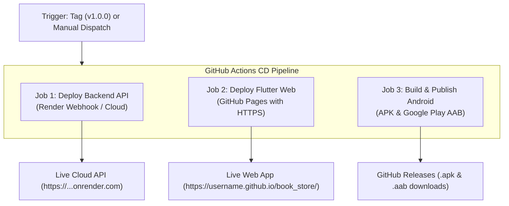

# 🚀 BookNest Continuous Deployment (CD) Guide

This guide explains how to use the automated Continuous Deployment (CD) pipeline in [deploy.yml](file:///.github/workflows/deploy.yml) to deploy **BookNest** (Backend API, Flutter Web, and Android Production Binaries) directly through GitHub.

---

## 🏗️ 1. Architecture of the CD Pipeline

Whenever the workflow is triggered, GitHub Actions runs three dedicated, automated deployment jobs:



1. **Backend Deployment**:
   - Validates Node.js syntax and dependencies.
   - Pings your **Render Deploy Hook** (or other cloud webhook) for zero-downtime deployment.
2. **Flutter Web Deployment (GitHub Pages)**:
   - Compiles `flutter build web --release --base-href "/book_store/"` with the production API URL.
   - Deploys the static web app directly to **GitHub Pages** (free 24/7 HTTPS hosting).
3. **Android Release Engineering**:
   - Compiles production `.aab` (Google Play Store format) and `.apk` (direct installation format).
   - Publishes both files directly to **GitHub Releases** with automated release notes and keeps artifacts for 30 days.

---

## ⚡ 2. How to Run the Deployment

### Method A: 1-Click Manual Dispatch (Recommended for first deploy)
1. Go to your repository on GitHub: `https://github.com/sarimsajjad38/book_store`
2. Click on the **Actions** tab at the top.
3. In the left sidebar, click on **Deploy BookNest (CD Pipeline)**.
4. Click the **Run workflow** dropdown button on the right:
   - Check/uncheck target components (`Deploy Backend`, `Deploy Web`, `Build & Publish Android`).
   - Optionally enter your production cloud API URL (e.g. `https://booknest-api.onrender.com/api`).
5. Click **Run workflow**.

### Method B: Automated Tag Release
Whenever you tag a new version in git and push it, GitHub automatically builds and publishes the release:
```bash
git tag v1.0.0
git push origin v1.0.0
```

---

## 🔑 3. Configuring GitHub Repository Secrets (One-Time Setup)

To allow GitHub Actions to trigger cloud deployments and sign Android binaries, add the following optional secrets in **GitHub Repository** $\to$ **Settings** $\to$ **Secrets and variables** $\to$ **Actions**:

| Secret Name | Description | Where to find it |
| :--- | :--- | :--- |
| `RENDER_DEPLOY_HOOK` | Webhook URL to trigger auto-deploy on Render | Render Dashboard $\to$ Service Settings $\to$ **Deploy Hook** |
| `PROD_API_URL` | Production API URL injected into Flutter Web & Android | e.g. `https://booknest-api.onrender.com/api` |
| `KEY_PROPERTIES` *(Optional)* | Content of `android/key.properties` for cloud signing | Your local `android/key.properties` file |
| `KEYSTORE_BASE64` *(Optional)* | Base64-encoded `upload-keystore.jks` | Run: `[Convert]::ToBase64String([IO.File]::ReadAllBytes('android/app/upload-keystore.jks'))` |

---

## 🌐 4. Enabling GitHub Pages (One-Time Setup for Web)

To enable free web hosting on GitHub Pages:
1. In your GitHub repository, navigate to **Settings** $\to$ **Pages** (in the left sidebar).
2. Under **Build and deployment** $\to$ **Source**, select **GitHub Actions**.
3. Once the workflow finishes, your live web app will be available at:
   `https://sarimsajjad38.github.io/book_store/`

